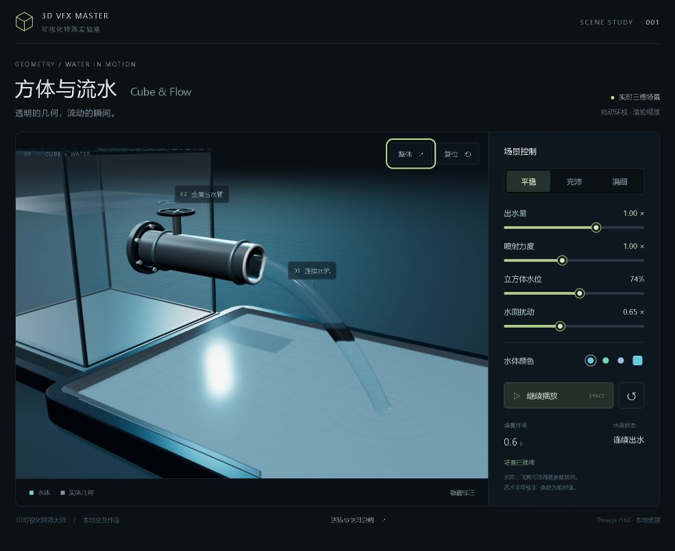

# 清透水流整合验证 · 2026-10-24

整合、安装与导出验证均已通过。技能包含 35 个内部模块、106 套预设，仍只有一个 SKILL.md 入口。

- 安装副本可用“清透水流 / 透明水流 / 管道出水 / clear water”检索新模块；默认导出与带 --look / --set 的导出在实际浏览器运行。
- [WebGL 结果](webgl-validation.json)：三套预设、四项参数可见变化、八个边界、四轮创建与释放、宿主相机和资源保留。水束透射 0.985、IOR 1.333；池底可透视；重力水滴触发落点波包；停水后已有涟漪在三秒检查窗口内消散且无新事件。
- [导出交互](host-validation.json)：蓝色 #006aff、涓细预设、pressure=1.2 生效；重置恢复导出配置；关水、恢复、暂停、播放与近景均正常。[新页面控制台](fresh-export-console.json)无 warning / error。
- [移动模块](mobile-validation.json)与[技能目录](gallery-mobile-validation.json)：390 × 844 iframe 无横向溢出；全部三套预设可切换；低功耗 100 水滴槽位分支通过。该检查不代表实体手机性能测试。
- [中英文搜索与来源筛选](gallery-search-validation.json)通过；原有 34 个模块、两套组合和工具脚本与此前交付版本逐字节一致，本地水流源工程也未改变。

结构检查、依赖指纹与来源记录见上级目录的包装校验和来源审计。全部检查范围与导出路径见 [validation.json](validation.json)。此前十轮验证保留为历史结果，本次新增模块进行了上述针对性验证。

可复跑的 [WebGL 页面](../../../assets/modules/3d-cube-waterflow/qa/check.html)和[移动页面](../../../assets/modules/3d-cube-waterflow/qa/mobile.html)随模块携带，完整导出后也可运行。

本次只更新本地技能源、已安装版本与压缩包，未发布网站。
